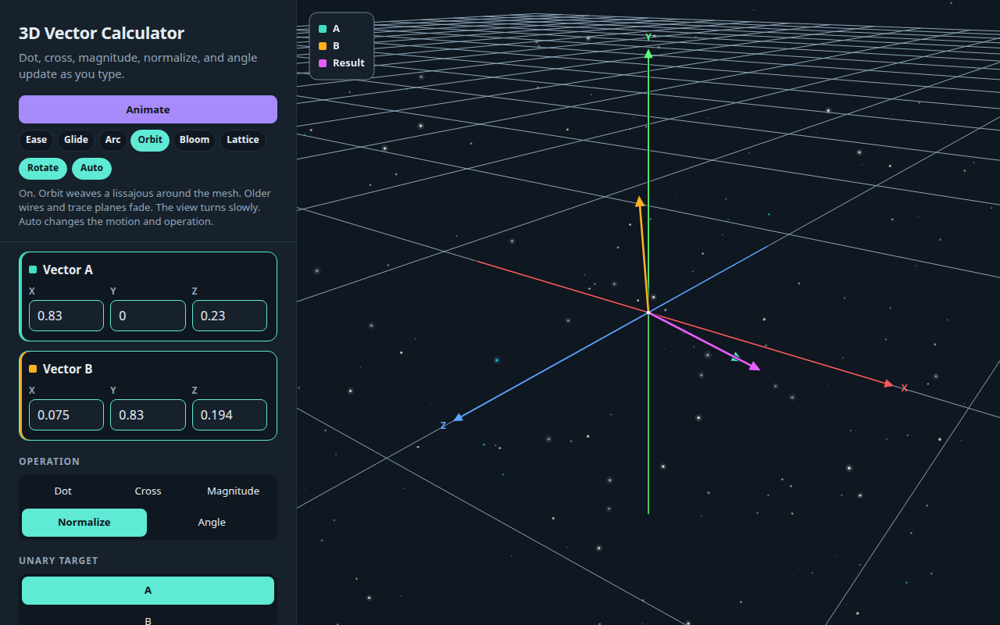

# 3D Vector Calculator

Compute dot product, cross product, magnitude, normalize, and the angle between two 3D vectors, with a live arrow view. This is a public demo built in [Agent Studio](https://studio.botz.ai).



A desktop workspace for checking 3D vector math. The page is a full-height split: a calculation panel on the left, and a large view on the right. The view is a 2D canvas with a hand-rolled perspective projection (Y-up, right-handed). It is not Three.js.

Dot, cross, magnitude, normalize, and angle update as you type. Angles are in degrees and displayed numbers use three decimal places. A fresh visit starts at A = (1, 0, 0) and B = (0, 1, 0). Magnitude and normalize use the selected vector; dot, cross, and angle use both. A zero-length vector shows a message instead of NaN.

Animate runs on a fresh visit in Orbit, with Normalize selected. Rotate and Auto start on: the camera turns slowly around the mesh, and the motion and operation step onward together. Ease, Glide, Arc, Orbit, Bloom, and Lattice blend from the vectors already on screen, and the previous wires fade out. Every few seconds the trace leaves a translucent plane; those planes fade as they get older. A starfield sits behind the grid. Changing the motion, rotate, or operation while the sweep runs keeps the clock and eases into the new setting, so the arrows, traces, result, and framing do not jump. The component fields, the result, and the arrows keep updating until Animate is pressed again. Visitors who prefer reduced motion start with the sweep paused.

Named vectors and calculation history stay in `localStorage`. The library key is `3d-vector-calculator:vectors` (at most 40 named vectors). The history key is `3d-vector-calculator:history` (the 30 newest rows, newest first). Each history row stores component snapshots, the operation, the unary target, and the result, so later edits do not rewrite the past. A failed write is caught and reported in the panel.

## Run

From the repository root:

```bash
npm start
```

That runs `node server.mjs` and serves `public/` at <http://localhost:4100> over plain HTTP on loopback. Localhost is a secure context, so the static app does not need TLS. Set `PORT` to choose another port. There are no npm dependencies.

```bash
npm test
```

That runs `node --test` on the math, storage, projection, and server tests. No extra test runner is required.


## Repository layout

- `public/`, `server.mjs`, `test/`: the app and its tests.
- `spec/`: the spec, subtasks, and status files the app was built from.
- `.studio/`: Agent Studio state for this demo: the board record (`board.json`, issues labelled `demo:3d-vector-calculator` in this repo), demo metadata, and review evidence.

Cards for this demo are issues in this repository. Agent Studio opens review pull requests here, and merging one completes the run.
