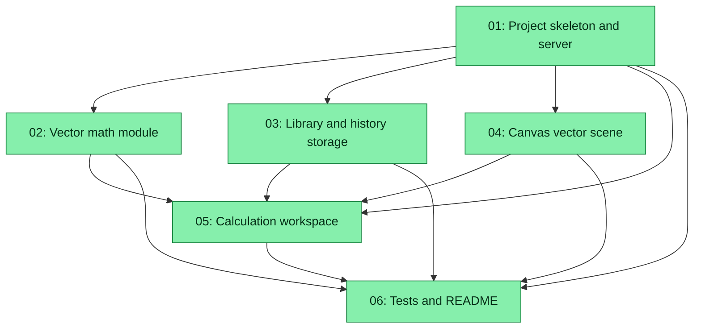

# Spec: 3D Vector Calculator

## Status
Completed

## Overview

A single-page calculator for people checking 3D vector math in graphics, physics, or coursework. The left side computes dot product, cross product, magnitude, normalize, and the angle between two vectors. The right side draws those vectors as colored arrows on a dark perspective grid, and named vectors plus recent calculations stay in the browser.

## Motivation

1. Vector identities are easy to mistype by hand, and a wrong cross-product direction is hard to spot from numbers alone.
2. A live arrow view next to the result makes direction, length, and angle checkable in one glance.
3. Keeping a named library and a short history locally lets someone reuse axes, velocities, or homework vectors without an account.

## Goals

1. Dot, cross, magnitude, normalize, and angle match known fixtures: i·j = 0, i×j = k, |(3,4,0)| = 5, normalize(2,0,0) = (1,0,0), and the angle between i and j is 90 degrees.
2. A zero-length input to normalize or angle shows a clear message and never displays NaN.
3. Saving a named vector, reloading the page, and loading it into A or B restores the same components.
4. Reopening a history row restores the operation, both operand snapshots, the unary target, and the result.
5. npm test passes and npm start serves the split workspace with zero npm dependencies.

## Non-Goals

- Three.js, WebGL libraries, a bundler, or any npm dependency
- Spherical or cylindrical conversion, matrices, quaternions, and transform gizmos
- Accounts, server-side storage, import/export files, and collaboration
- A mobile-first layout; the target is a desktop split workspace
- Editing a past history row in place, or persisting the unsaved draft separately from history

## Key Decisions

- **KD-1 Zero-dependency stack.** Node.js 22 serves public/ with node:http and the client is vanilla ES modules. package.json lists no dependencies. Persistence is localStorage. Tests use node:test. Nothing is loaded from a CDN.

- **KD-2 Canvas perspective instead of Three.js.** The 3D view is a 2D canvas with a hand-rolled perspective projection, Y-up and right-handed. It draws an XZ grid, an RGB axis triad, and arrows for A, B, and a vector result. Drag orbits the origin and the wheel zooms. Camera basis math stays inside the scene module so it does not import the vector-math module.

- **KD-3 Pure math, degrees, three decimal places.** public/math.js touches no DOM, so node:test can import it. Angle is acos of the clamped cosine, converted to degrees. normalize and angleDegrees return null when either required vector has magnitude 0. The result panel formats with three decimal places; stored results keep full precision.

- **KD-4 Snapshots, caps, and a storage factory.** History stores component snapshots, not live library ids, so later edits or deletes do not rewrite the past. Calculation adds a target field of A or B for magnitude and normalize. createStore(storageArea) accepts localStorage in the browser and a memory map in tests. Named vectors cap at 40 and history at 30, newest first. Writes are try/caught.

- **KD-5 One live result.** Dot, cross, and angle always use A and B. Magnitude and normalize use the selected target, default A. Inputs recompute immediately. A result arrow is drawn only for cross and normalize. A fresh visit with an empty library starts from A = (1, 0, 0) and B = (0, 1, 0).

## Requirements

1. FR-1: The user can enter vectors A and B as numeric x, y, and z components.
2. FR-2: The user can compute the dot product of A and B and see a scalar.
3. FR-3: The user can compute the cross product A × B and see the resulting vector.
4. FR-4: The user can compute the magnitude of the selected vector, A or B.
5. FR-5: The user can compute the unit vector of the selected vector, A or B.
6. FR-6: The user can compute the angle between A and B in degrees, shown to three decimal places.
7. FR-7: A zero-length vector used by normalize or angle, and any non-numeric component, shows a clear message and no NaN.
8. FR-8: The right pane draws A and B, plus a result arrow when the result is a vector, on a light grid with an axis triad.
9. FR-9: The user can drag to orbit the view and use the wheel to zoom, without losing the origin.
10. FR-10: The user can save the current A or B under a name, load a saved vector into A or B, and delete it.
11. FR-11: The user can reopen a recent calculation and restore its operands, operation, target, and result.
12. FR-12: Named vectors and history persist in localStorage across reloads, within the stated caps.
13. FR-13: The workspace is a full-height split: a calm dark calculation panel on the left and a large dark viewport on the right.

## App Blueprint
- **Stack**: Node.js 22 static server (node:http) + vanilla ES modules + node:test
- **Run**: `npm start` from `demos/3d-vector-calculator/`
- **Entities**: `Vector` (id, name, x, y, z); `Calculation` (id, operation, target, vectorA, vectorB, result, createdAt)
- **Screens**: Workspace: calculation panel, library, and history on the left; large 3D view on the right

## Subtask Manifest

| ID | File | Subagent | Dependencies | Phase | Status |
|----|------|----------|-------------|-------|--------|
| 01 | `subtask-01-3d-vector-calculator-skeleton-20261112.md` | generalPurpose | — | 1 | Completed |
| 02 | `subtask-02-3d-vector-calculator-vector-math-20261112.md` | generalPurpose | 01 | 2 | Completed |
| 03 | `subtask-03-3d-vector-calculator-storage-20261112.md` | generalPurpose | 01 | 2 | Completed |
| 04 | `subtask-04-3d-vector-calculator-scene-20261112.md` | generalPurpose | 01 | 2 | Completed |
| 05 | `subtask-05-3d-vector-calculator-workspace-20261112.md` | generalPurpose | 01, 02, 03, 04 | 3 | Completed |
| 06 | `subtask-06-3d-vector-calculator-tests-readme-20261112.md` | generalPurpose | 01, 02, 03, 04, 05 | 4 | Completed |

## Subtask Dependency Graph

## Execution Order

Phases are derived from the dependency graph. Subtasks within a phase have no dependencies on each other and may run in parallel.

### Phase 1
| ID | Subagent | Description |
|----|----------|-------------|
| 01 | generalPurpose | Create the zero-dependency app root, a static server, and the dark split shell the later modules fill in. |

### Phase 2 (parallel)
| ID | Subagent | Description |
|----|----------|-------------|
| 02 | generalPurpose | Implement the five operations as pure functions with safe results for zero-length vectors. |
| 03 | generalPurpose | Persist named vectors and calculation snapshots in a swappable storage area with caps. |
| 04 | generalPurpose | Draw the grid, axes, and arrows in perspective and let the user orbit and zoom. |

### Phase 3
| ID | Subagent | Description |
|----|----------|-------------|
| 05 | generalPurpose | Wire the left panel to the math, storage, and scene so the five operations, library, and history work live. |

### Phase 4
| ID | Subagent | Description |
|----|----------|-------------|
| 06 | generalPurpose | Lock the math, storage, projection, and server behavior in node:test, and document how to run the app. |

## Definition of Done

- [x] All subtasks completed
- [x] npm test passes
- [x] npm start serves the dark split workspace with zero npm dependencies
- [x] The five operations match the fixture values and zero-length inputs do not show NaN
- [x] Named vectors and history survive a reload and can be reused

## Risks

| Risk | Likelihood | Impact | Mitigation |
|------|-----------|--------|------------|
| acos receives a cosine slightly outside [-1, 1] for nearly parallel vectors and the angle becomes NaN | Medium | High | Clamp the cosine to [-1, 1], treat magnitude below 1e-12 as zero, and cover parallel, anti-parallel, and over-range fixtures in test/math.test.mjs |
| localStorage throws in private mode or when the quota is full, so saves silently disappear | Medium | Medium | Cap named vectors at 40 and history at 30, catch setItem failures in createStore, and show a save-failed message in the panel |
| The custom projection clips long arrows or flattens depth, so the view is hard to read compared with the requested Three.js scene | Medium | Medium | Frame the camera to the longest arrow, keep a minimum extent of 2, offer orbit and zoom, and unit-test project() for center, up, and right |

## Rollback Plan

1. Delete demos/3d-vector-calculator/ and re-run the executor
2. Do not add npm packages while restoring; the app stays on node:http, vanilla modules, localStorage, and node:test

## Execution Notes

[To be filled by the executor]
